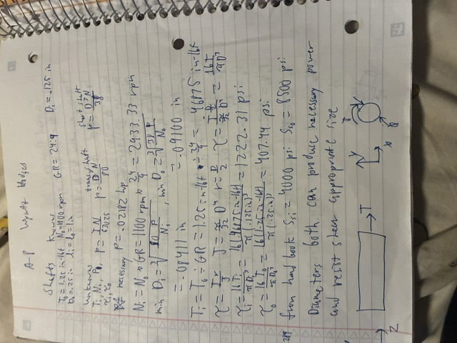
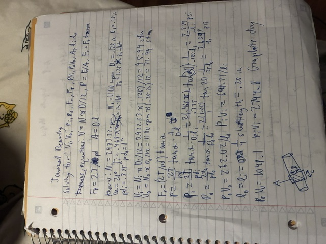
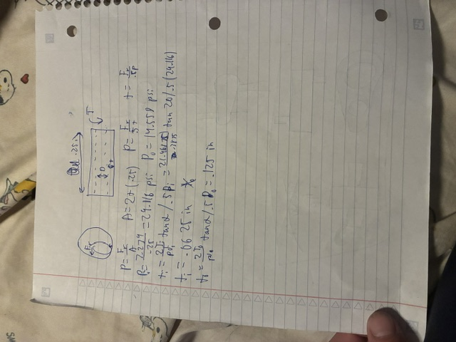
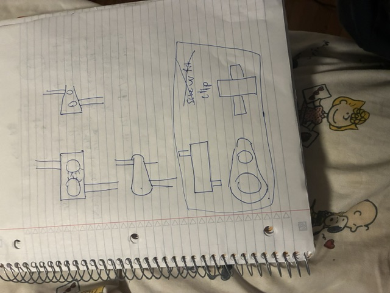
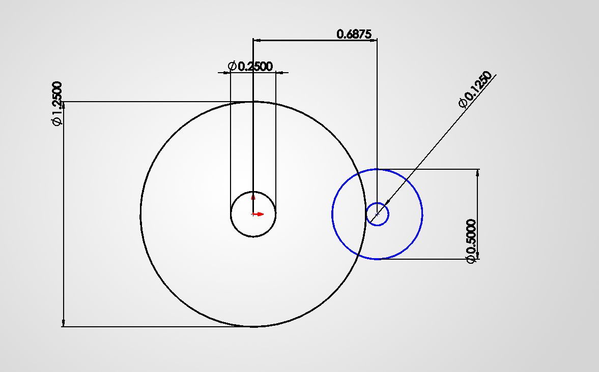
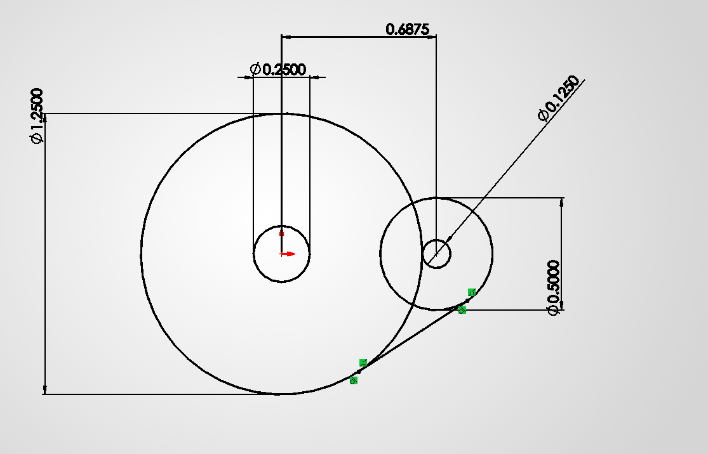
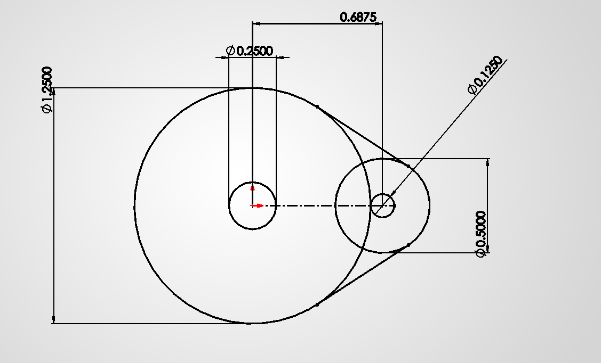

# A8 – Gears

## Objective
The objective of this assignment is to create a gearbox housing for 2 spur gears with a 24:9 gear ratio that will out put 1.25 in-lbf of force while spinning at a speed of 1100 RPM. The shaft diameter and gears that will be used are given in the assignment, the transmission shaft will have a diameter of .125 inches and the short shaft connected to the output gear will have diameter of .25 inches. 

### Shafts
The first step of the process is to verify that the two gear shafts will have a large enough area to drive the necessary torque without breaking because of shear stresses. The governing equations for these problems are the gear ratio relationship, the power equation for gear shafts, and the shear stress equation for shafts. From the power equation P=TN/63025 I can find the horse power required to drive this gear to achieve the torque and speed goals. Once I solved for the power being generated I could then plug those numbers into the equations relating diameter and power to see if the given diameters could handle that much power which they could, the min necessary diameters for the input and output shafts respectively are .08411 inches and .09100 inches. After checking the shafts for the necessary strength I solved for the shear stress in both shafts. Using the equations from lecture I found the shear stresses were 1222.31 psi for the input shaft and 407.44 psi for the output shaft. 

### Journal Bearings
For the journal bearings the necessary material is dependent on the pressure exerted by the shaft trying to deflect and its speed, in surface feet per minute. Solving for speed can be done with the given RPM and the input RPM I solved for using the gear ratio and those numbers came out to be 95.99 sfm and 71.99 sfm, in and out respectively. The next step is to solve for the pressure, which is dependent on the radial force and cross sectional area of the shaft within the bearing(from lecture). The radial force is dependent on the tangential force and the pressure angle, and the tangential force is dependent on torque and the pitch diameter. After algebraically solving for P the equation is P=(2T/pd)*tan(alpha)/(D*l), where T is torque, pd is pitch diameter, alpha is the pressure angle, D is the shaft diameter, and l is the length of the bearing and can be decided by me. I then solved for P in both bearings and found the input to equal 7.279/l psi and the output to equal 3.6397/l psi. Once I found PV to equal 262.02/l in the output and 698.71/l for the input and found that PV would be less than the limit for almost any material if the journal bearing was .25 in long. I Decided to use dry graphite for the material because there was a lot of tolerance between the PV limit and the found PV values. For the bearing thickness I used the same P equation to solve for pressure but had area equal to 2t * l so when I rearanged the equation to solve for thcikness I found t = Fr/(.5P).

### Gearbox
For my gearbox I decided to create a symmetrical housing with 2 identical sides except one would have the male side of the clips and the other female. My design is pretty much two circles that outline the gears connected by straight tangent lines, refer to the sketch/models.   

## Models 
The input shaft is a .125 inch diameter circle extruded 1 inch and the output shaft is a .25 inch diameter circle extruded 1 inch

The Gear box I started by drawing concentric circles for where the gears would be sitting and a hole for their shaft/bearings. The cricles were spaced .6875 inches because that is the center distance calculated from (pd1+pd2)/2. I then connected the two outer circles with a tangent line mirrored over the center line to close out the shape before extruding and creating a shell I extruded them each .25 inches with a .05 inch shell so the gears would fit securely without rubbing against the housing, based off of dimensions given on mcmasters. I then designed the clips by creating a box with draft on one gearbox and a hook shaped flange on the other so the hook could easily slide over the box and attach to the other housing. 

For the assembly the first step was to make my parts not fixed so the could be free to mate with each other I then created 2 center lines spaced .6875 to use as reference for the parts. I first made the gears concentric with the centerlines so they were correctly spaced and then added the gear mate between the two so they interacted correctly. After mating the gears I inserted the shafts by making the ends coincident with with gear faces and concentric with the centerlines. I next added the gear housings by setting the shaft holes concentric to their respective centerlines then offset one housing .1 inches from the face of a gear and the other coincident with the faces that meet when the box is closed. Lastly I added the bearings by making them concentric with the centerlines and coincident with the inside faces of the gear housing.  

## Links
[18tooth]
[48tooth]
[Gearhouse1Part]
[Gearhouse1Drawing]
[Gearhouse2Part]
[Gearhouse2Drawing]
[InputBearingPart]
[InputBearingDrawing]
[OutputBearingPart]
[OutputBearingDrawing]
[ShortShaftPart]
[ShortShaftDrawing]
[TransmissionShaftPart]
[TransmissionShaftDrawing]
## Communicate

This took me about 9 hours to get done. I learned about how bearings functions and the importance of material selection for that process of designing bearings. I also learned about the importance of shaft size and strength in gearboxes for transmitting the correct amount of power without breaking or deforming from stress. 
