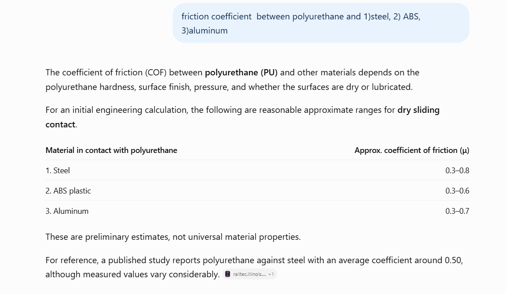
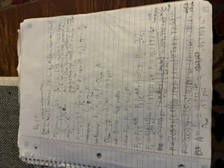
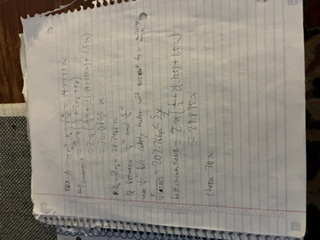
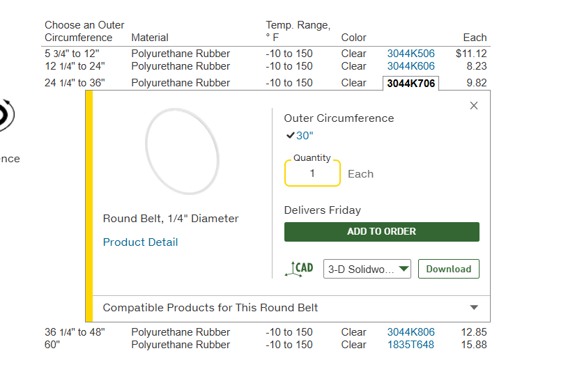
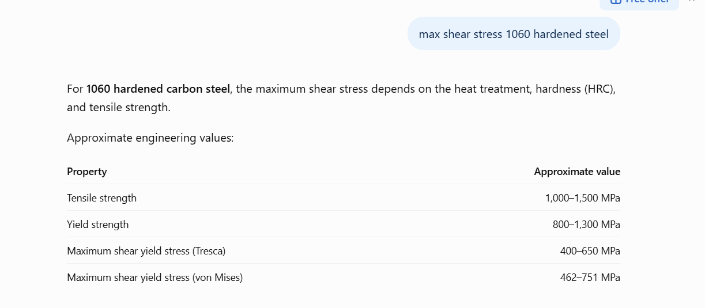
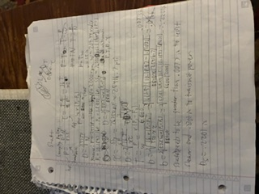
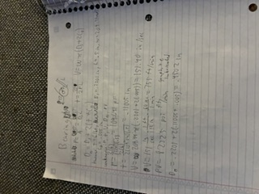
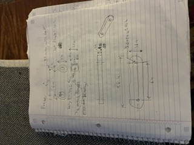

# A9 – Pulleys

## Objective
The objective of this assignment is to design a pulley system that meets the necessary requirements. The parts I am designing are the belt, shafts, bearings, and a support frame.

## Analyze

For this assignment the pulley needed to be spaced 4-6 inches apart, have 3 inch diameters, run at operating speeds between 1000 and 2000 rpm, have a static tension between 4 and 6 pounds, be made from aluminum, ABS, or steel, have a minimum safety factor of 3, and the belt is to be made from polyurethane which has a yield strength of 471 psi at 20% strain.

## Decide
I decided to space my pulleys 6 inches apart, run at 2000 rpm, have a static tension of 6 pounds, and a safety factor of three so it could produce the most power. I then chose steel as the material because it has the largest friction coefficient compared to the other materials (found with AI) 

## Communicate
### Belt
I started solving for the belt diameter by listing all my known values and equations that are related to pulley forces and drawing a FBD, then listed my unknown values. I decided to set the angle of the pulley to pi because that is a normal pulley. Once I set the angle I was left with 4 unknowns and 4 equations and solved for the driving force of the pulley and the area required to support that amount of stress. I found the max stress by dividing the yield stress by the safety factor. I then divided the driving force by the max stress to find the minimum cross sectional area and diameter of the belt. I was then able to find the belt circumference and look up a suitable one on mcmaster. After going to mcmaster I found that my desired diameter was between 2 standard sizes. Because I had a safety factor implemented when I made my calculations I decided to use the smaller of the 2 belts, 1/4", then solved for the necessary circumference with this diameter, 30 in.

### Shaft
I started solving the shaft by drawing a FBD and listing equations relating power, torque, and shear. I then listed my knowns (found yield shear stress of 1060 hardened steel using AI) and unknowns and algebraically solved for the shear, torque, and diameter required for the power and shear. After solving i found the shaft needed a .0073 inch diameter to resist shear and a .2201 inch diameter to generate the necessary power. 

### Bearing 
I solved for the bearing material and thickness the same way by drawing a free body diagram, and listing applicable equations with known and unknown values. I did assign a length of .5 inches to my bearing. I first solved for the pressure and thickness of the bearing then found its velocity and PV rating then finally its total diameter. looking at the table in the machineries handbook the only material that could support this speed and pressure is lubricated graphite.

### Frame
For the frame I kept the design simple. I first needed to find the total dimensions of the pulley by adding its components. Once I knew the total length and width of the pulley I added .1 inches for clearance and made the holes the correct size to press fit the bearings. the depth is .4 inches so the bearings easily fill their housing. 

This assignment took me about 4 hours to complete and I learned about different things to take into account when designing a pulley and that greater friction creates larger power transmission.
