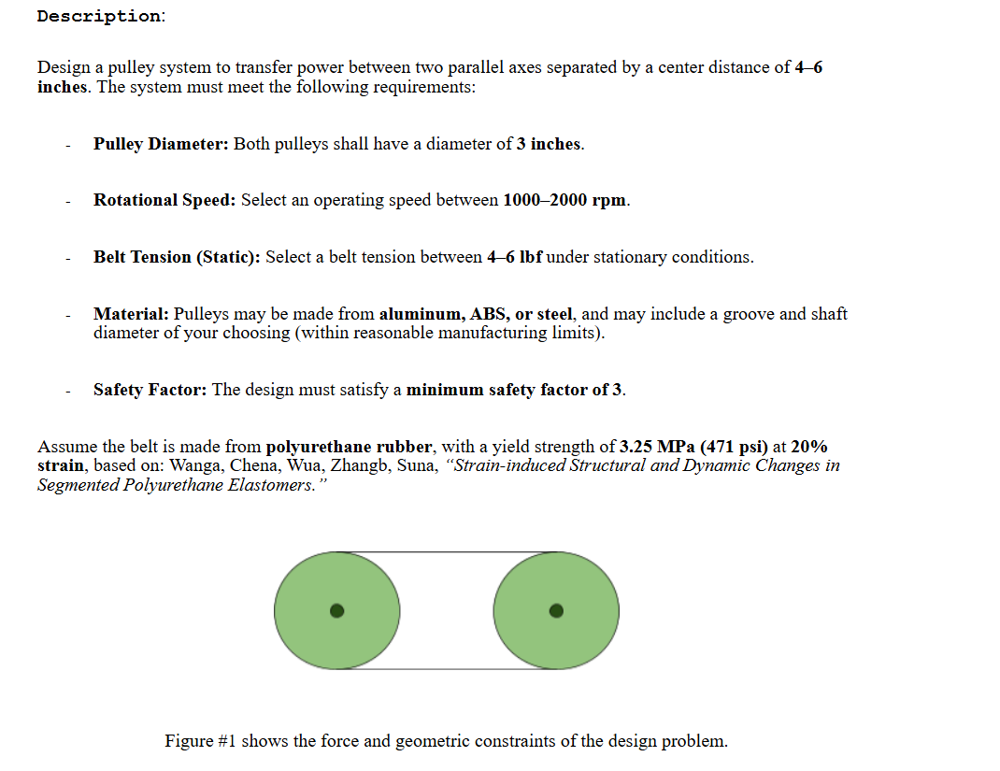

# A9 – Pulleys

## Objective
The objective of this assignment is to design a pulley system that meets the necessary requirements. The parts I am designing are the belt, shafts, bearings, and a support frame.

## Analyze

For this assignment the pulley needed to be spaced 4-6 inches apart, have 3 inch diameters, run at operating speeds between 1000 and 2000 rpm, have a static tension between 4 and 6 pounds, be made from aluminum, ABS, or steel, have a minimum safety factor of 3, and the belt is to be made from polyurethane which has a yield strength of 471 psi at 20% strain.

## Decide
I decided to space my pulleys 6 inches apart, run at 2000 rpm, have a static tension of 6 pounds, and a safety factor of three so it could produce the most power. I then chose steel as the material because it has the largest friction coefficient compared to the other materials (found with AI) 

## Communicate
### Belt
I started solving for the belt diameter by listing all my known values and equations that are related to pulley forces, then listed my unknown values. I decided to set the angle of the pulley to pi because that is a normal pulley. Once I set the angle I was left with 4 unknowns and 4 equations and solved for the driving force of the pulley and the area required to support that amount of stress. I found the max stress by dividing the yield stress by the safety factor. I then divided the driving force by the max stress to find the minimum cross sectional area and diameter of the belt. I was then able to find the belt circumference and look up a suitable one on mcmaster. After going to mcmaster I found that my desired diameter was between 2 standard sizes. Because I had a safety factor implemented when I made my calculations I decided to use the smaller of the 2 belts, 1/4", then solved for the necessary circumference with this diameter, 30 in.   
