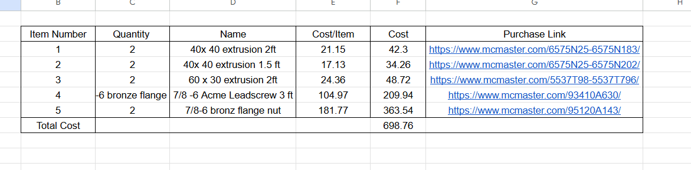

# A10 – Lead Screw Translating System

## Objective
The objective of this assignment is to design a desktop sized tensile tester that can support a 2 kN load, and is driven by a lead screw moving between 1-50mm/min with a safety factor of 3

## Analyze
### Lead Screw
We started the process by determining the minimum necessary diameter using the axial stress equation. The force is 224.81, the safety factor is 3, and I found the properties of the lead screw by asking AI "common lead screw materials" and then asked for "properties of AISI 1018" the yield and shear strength were 53700 psi and 31005 psi respectively." After algebraically solving for d min and plugging the values in I found the minimum diameter to be .1265 inches.

I decided to use the 3/8" screw for extra safety. Next was to solve for the range of rotational speeds of the lead screw which is equal to linear speed divided by the pitch, which means as pitch increases driving torque also increases so the smallest pitch possible is the one we used (.05 in/rev). If the pitch is equal to .05 the range of rotational speeds would be .7874-39.38 RPM. Once I had the pitch I could solve for the max torque the screw could support and the driving torque. Since the driving torque was less than the max torque the 3/8-20 screw would work.

### Flange Nut
The knowns for the Flange nuts are the material is bronze the SF is equal to 3 the force is 1 kN and the diameter and pitch come from the previous problem 3/8" diameter and .05 in/revolution pitch. I found the yield strength by asking AI "properties of bronze 673"  and it was equal to 40000 psi. To solve for the correct nut I used the thread bending stress equation and algebraically solved for the minimum number of engaged threads to keep the threads from bending with the 3/8- 20 lead screw there needed to be 1.72 threads engaged which means the nut needed to be at least .1 inches long. 

### Crosshead 
I solved for the minimum length of the crosshead by modeling it as a beam fixed at both ends with a load in the center. The center load is 2kN the cross sectional area of the beam is a 3 in square, the max deflection is equal to .00394 in, and the material is aluminum which has a yield strength of 40000 psi and a modulus of elasticity equal to 10000000 psi. I was able to solve for the max length that could support the load without yielding or deflecting too much which was 1067.6 in and 29.33

## Decide
### Frame
We decided to make our frame look the same as the example in the assignment and this is how our BOM turned out.

### Crosshead 
When designing the crosshead we thought it would be easiest to make it a straight bar with holes for the leadscrew to fit in and small circular slots for the flange nuts to slide into. 

## Communicate
After my partner had finished working on the CAD model I realized I made a mistake when calculating the nut size from the thread bending stress so our lead screw is much larger than what is calculated for but should still work if we have a strong enough motor. I learned that things like mechanical components are the most susceptible to forces when analyzing strength. 

