# A10 – Lead Screw Translating System

## Objective
The objective of this assignment is to design a desktop-sized tensile tester that can support a 2 kN load, and is driven by a lead screw moving between 1–50 mm/min with a safety factor of 4.

## Analyze
### Lead Screw - Wyatt
We started the process by determining the minimum necessary diameter using the axial stress equation. The force was 224.81, the safety factor was 4, and I found the properties of the lead screw by asking AI for "common lead screw materials" and then asked for "properties of AISI 1018." The yield and shear strength were 53700 psi and 31005 psi, respectively." After algebraically solving for d min and plugging the values in I found the minimum diameter to be .1265 inches.

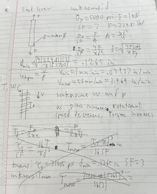

I decided to use the 3/8" screw for extra safety. Next was to solve for the range of rotational speeds of the lead screw which is equal to linear speed divided by the pitch, which means, as pitch increases, driving torque also increases, so the smallest pitch possible is the one we used (.05 in/rev). If the pitch is equal to .05, the range of rotational speeds would be .7874–39.38 RPM. Once I had the pitch, I could solve for the max torque the screw could support and the driving torque. Since the driving torque was less than the max torque, the 3/8-20 screw would work.

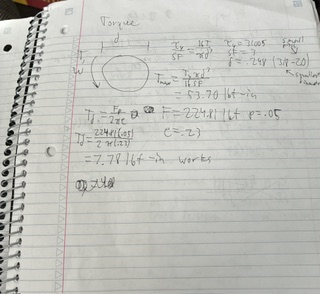

### Flange Nut - Wyatt
The best knowns for the flange nuts are that the material is bronze, the SF is equal to 4, the force is 1 kN and the diameter and pitch come from the previous problem: 3/8" diameter and .05 in/revolution pitch. I found the yield strength by asking the AI "properties of bronze 673" and it was equal to 40000 psi. To solve for the correct nut, I used the thread bending stress equation and algebraically solved for the minimum number of engaged threads. To keep the threads from bending with the 3/8–20 lead screw, there needed to be 1.72 threads engaged, which means the nut needed to be at least 1 inch long.

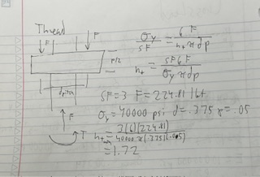

### Crosshead - Wyatt
I solved the minimum length of the crosshead by modeling it as a beam fixed at both ends with a load in the center. The center load is 2kN, the cross-sectional area of the beam is 3 in square, the max deflection is equal to .00394 in, and the material is aluminum which has a yield strength of 40000 psi and a modulus of elasticity equal to 10000000 psi. I was able to solve for the max length that could support the load without yielding or deflecting too much, which was 1067.6 in and 29.33.

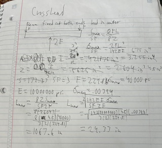

## Decide - Wyatt & Aiden
### Frame
We decided to make our frame look the same as the example in the assignment and this is how our BOM turned out.

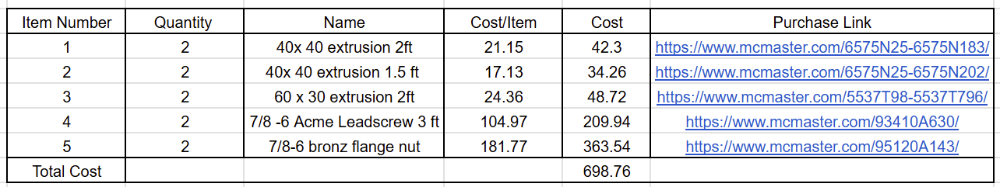

LINKS:
https://www.mcmaster.com/6575N25-6575N183/

https://www.mcmaster.com/6575N25-6575N202/

https://www.mcmaster.com/5537T98-5537T796/

https://www.mcmaster.com/93410A630/

https://www.mcmaster.com/95120A143/

### Crosshead - Wyatt
When designing the crosshead we thought it would be easiest to make it a straight bar with holes for the leadscrew to fit in and small circular slots for the flange nuts to slide into. We chose ATSM A36 as the material for its stiffness.

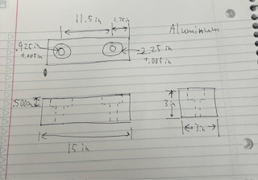

### CAD - Aiden
To start off the CAD, I began adding my parameters to my crosshead. I added counterbores for a cleaner for the flanges to sit in. I also chose a length that was less than the maximum length in order to keep the desktop size.

After the parametric equations were set in the screenshots below, is the process I used to create the design.

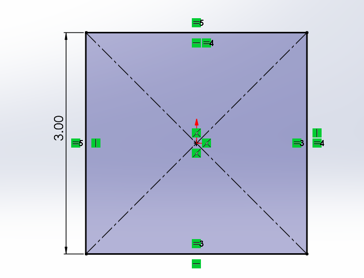

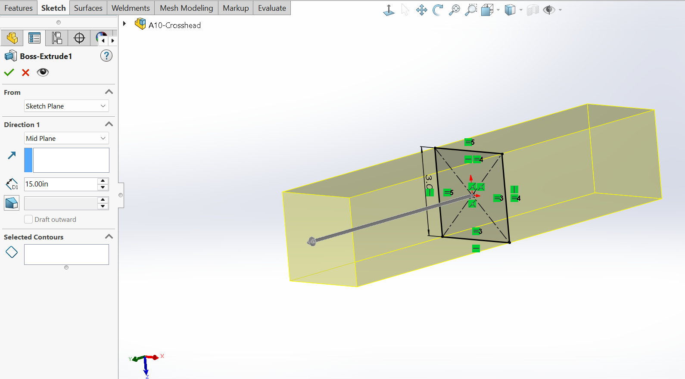

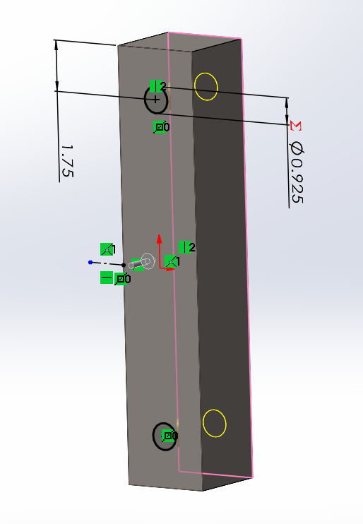

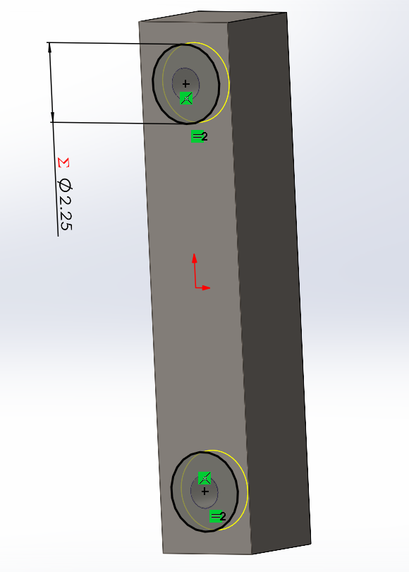

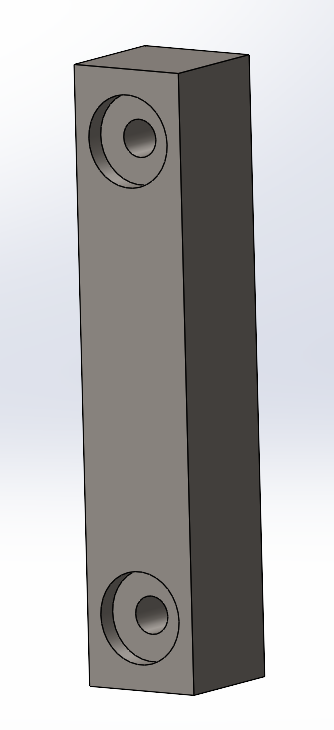

Once the crosshead was complete, it was time to assemble the frame. I took advantage of the McMaster Carr add-on in Solidworks to easily insert my components into the assembly. I used all the parts that we decided on in the design phase of this project.

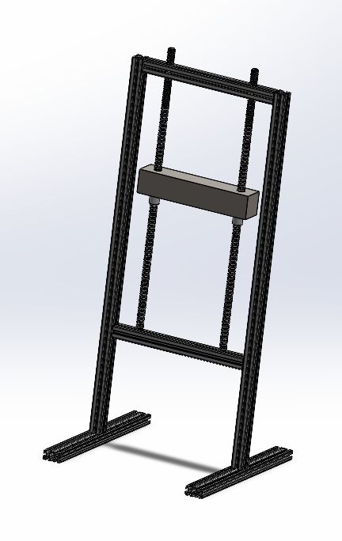

### FEA - Aiden
For the FEA, I started off by adding my fixed geometry and created a split line to add my 2kN force in the center of the crosshead. In the screenshot below is the FEA setup.

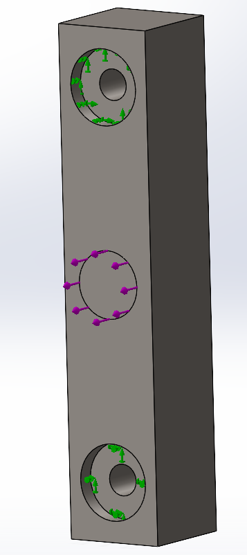

Once it was set up, I ran the FEA of my original design and afterwards, created two more meshes to make the FEA run more accurately. In the screenshots below are the original run.

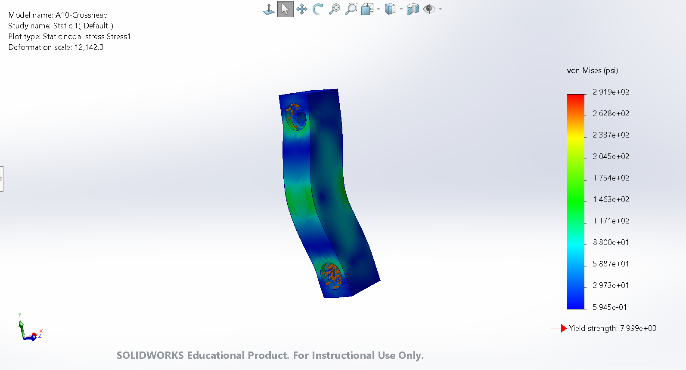
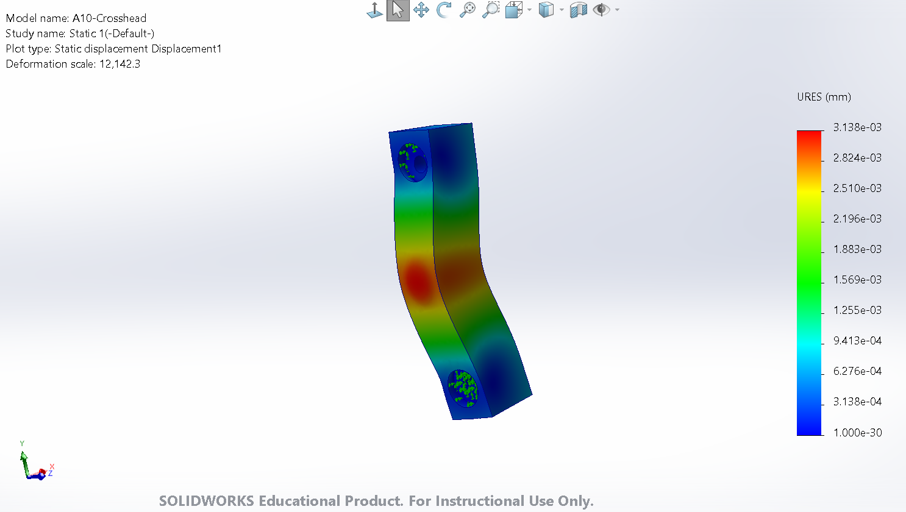
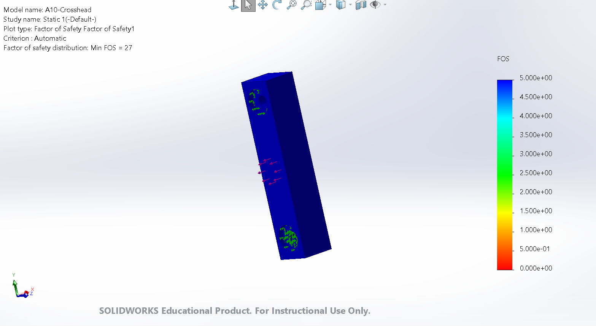

Seeing how all the parameters were met, I made a cutout for the sides to reduce the weight. After editing the design, I then ran three FEAs to get accurate results. In the screenshots below are the original run and the results from both tests. By the last run, all 3 tests convergence were within 7%.

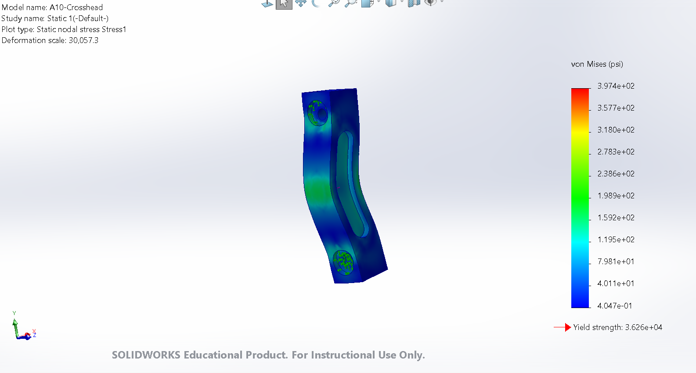
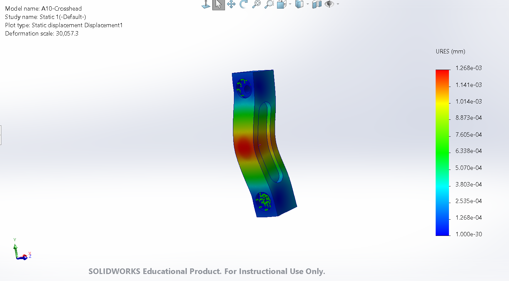
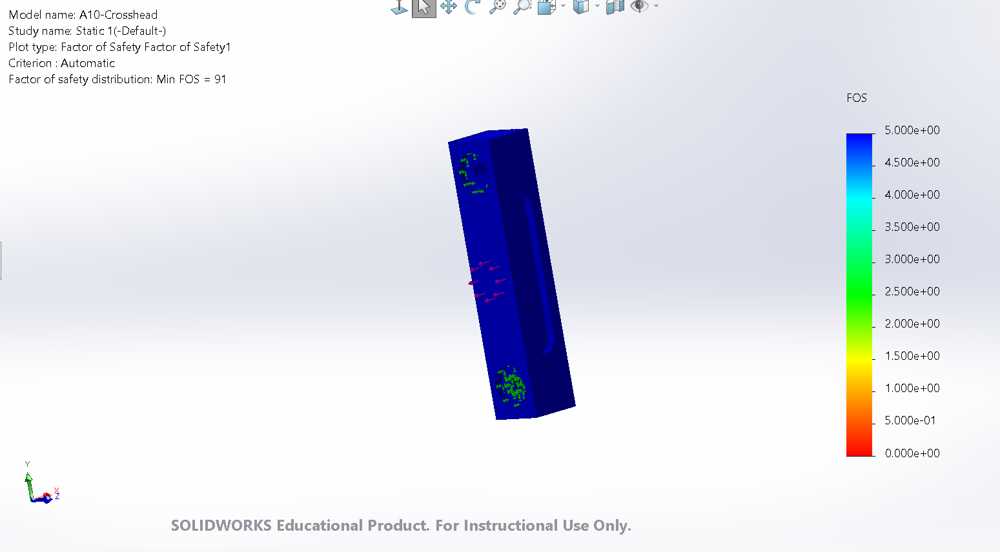

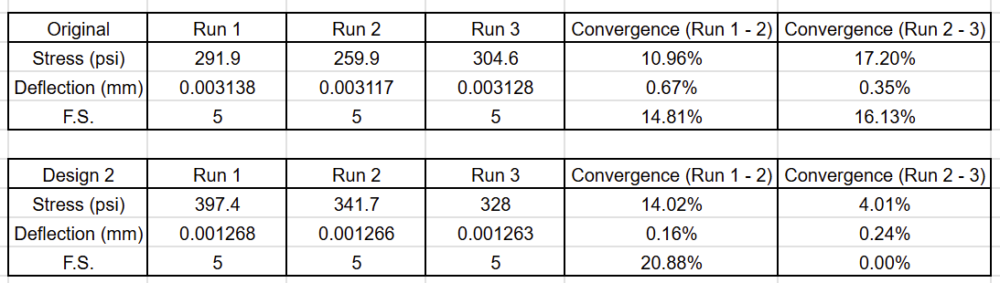

### Drawing - Aiden
I created the drawing of the original crosshead design following the ASME Y14.5 standards and added tolerance to critical components.

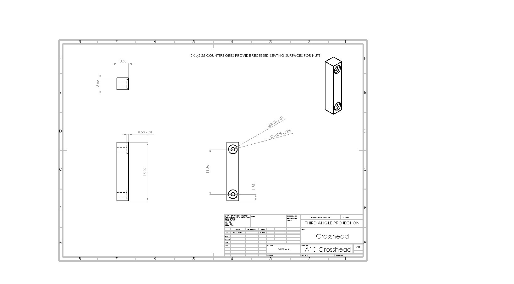

## Communicate and Lessons Learned
After my partner had finished working on the CAD model, I realized I made a mistake when calculating the nut size from the thread bending stress, so our lead screw is much larger than what is calculated for but should still work if we have a strong enough motor. I learned that things like mechanical components are the most susceptible to forces when analyzing strength. Also, learning how to consider a budget when it comes to creating assemblies, as our frame is quite expensive. In total, this assignment took about 6 hours to complete.

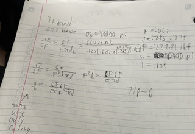

### Files

[A10.zip](A10.zip)

