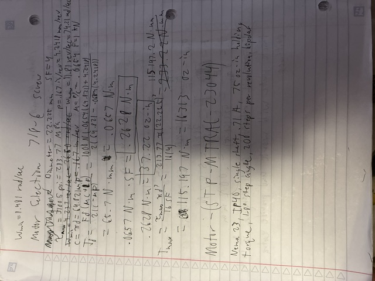
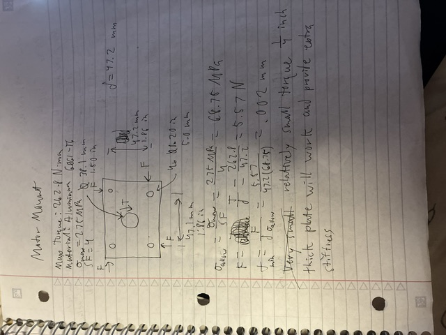

# A11 – Motor Selection

## Objective

## Analyze

## Decide
_Reference your concept selection (Pugh matrix) here. How does this design follow from that decision?_

## Communicate
[Motor Buy](https://www.automationdirect.com/adc/shopping/catalog/motion_control/stepper_systems/single_shaft_stepper_motors/stp-mtrac-23044)
[Motor Specs](https://cdn.automationdirect.com/static/specs/surestepACmotors.pdf)
[Motor Drawing](https://cdn.automationdirect.com/static/drawings/STP-MTRAC-23044.pdf)
[Coupler Buy](https://www.globalindustrial.com/p/set-screw-coupling-grc-087-kw?gad_source=1&gad_campaignid=22805635430&gclid=Cj0KCQiAk_DXBhCoARIsAHE-omNv7oS7ECZZFHwIFZt94e5Odfwjc2Ry06rL9F94ijz0Yzebn3cqbdIaAgf5EALw_wcB)
