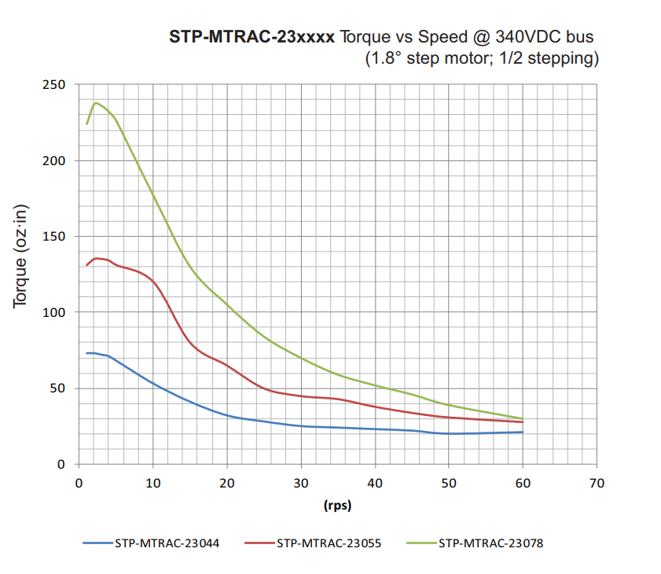

# A11 – Motor Selection

## Objective
The objective of this assignment is to select an appropriate motor for the tensile tester designed in A10 and design a way to mount the motor so the tester works correctly. 

## Analyze
The first part of the assignment is to select a motor than can support the driving torque and rotational speed found during A10. Once I converted the units to oz-in and rps I could look at the graph and find an appropriate motor. The motor would need a torque of 37.22 oz-in and a rotational speed ranging from .236 to 11.81 rps.

After finding a datasheet detailing different SureStep High Voltage motors I looked for a graph that would fit these specifications. I tried to find one with a torque speed curve that intersected 37.22 oz-in and 11.81 rps. I found the STP-MTRAC-23044 met my requirements for driving torque and max speed. I then looked to make sure the torque produced at the minimum rps would be bellow the max allowable torque, 16313 oz-in, which it was.

For the motor mount I designed a face plate to attach the motor to the extrusion making up the top frame. The dimensions for the motors face were avaiulable online so screw hole dimensions for connecting the mount to the motor will be correct. I then had to find a thickness for the plate so it wouldn't break. I found the plate only needed to be .002 mm thick so i decided to make it 1/4 inch thick because that is a standard aluminum sheet sized.  

For the coupler I needed to determine the necessary outer diameter to support the load in the motor and screw. I used an equation relating shear stress, torque and the bearings cross sectional area to find the outer diameter. Max stress was set equal to 250 MPa divided by my safety factor of 4 cause that is a standard value for steel, The same torque as before was used, and the inner diameter equals the lead screw diameter 7/8 inches. After solving for outer diameter I found it needed to have a total diameter of 2.06 inches. 

## Decide
_Reference your concept selection (Pugh matrix) here. How does this design follow from that decision?_

## Communicate
[Motor Buy](https://www.automationdirect.com/adc/shopping/catalog/motion_control/stepper_systems/single_shaft_stepper_motors/stp-mtrac-23044)
[Motor Specs](https://cdn.automationdirect.com/static/specs/surestepACmotors.pdf)
[Motor Drawing](https://cdn.automationdirect.com/static/drawings/STP-MTRAC-23044.pdf)
[Coupler Buy](https://www.globalindustrial.com/p/set-screw-coupling-grc-087-kw?gad_source=1&gad_campaignid=22805635430&gclid=Cj0KCQiAk_DXBhCoARIsAHE-omNv7oS7ECZZFHwIFZt94e5Odfwjc2Ry06rL9F94ijz0Yzebn3cqbdIaAgf5EALw_wcB)
[Bearing Buy](https://www.amazon.com/HiPicco-R14-2RS-Bearings-Bearing-Pre-Lubricated/dp/B0C74W39BB/ref=sr_1_2?crid=5GNNAVE73JOK&dib=eyJ2IjoiMSJ9.hKAp4o3YCNm1tyETi0VMVbWhtKWF7_QyjO3opa-z4Akd_Wmh4dgmQtYmQbxZZBtWDEJvGur77VPyGxmfQrqQ9Ydtw5E3m468nXU8wHhmwGxV7z-gu0im-YAlqo2rodKktB-eWmFH4PmZ29DGKRMMrYyHple9A7pj-U5AVYSmzzbYoqBmPHKHHbNH3QUsJpCcBs0LPZ6E-_yPZR2eFqTK1Zck8abf1NjVhqVep6CXSbA.hf6FUlpp_SXoCopidrgsUIW4qqxmRQp2CoG6c38yYGg&dib_tag=se&keywords=.875%2Bid%2Bbearing&qid=1794988586&sprefix=875%2Bid%2Bbearing%2Caps%2C217&sr=8-2&th=1)
